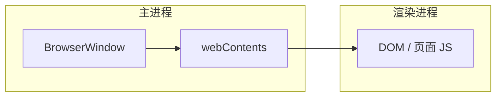
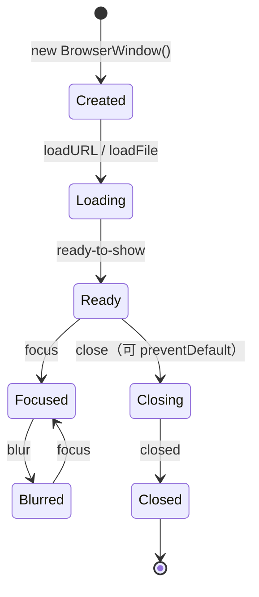

# 窗口与 WebContents

## 本章目标

- 掌握 `BrowserWindow` 的核心配置，尤其是影响首屏体验的选项。
- 理解窗口与 `webContents` 的关系，能管理多窗口的生命周期与消息路由。
- 会用 `WebContentsView` 组织多视图布局，替代已废弃的 `BrowserView`。
- 能处理窗口崩溃、加载失败、导航劫持等异常场景。

## 窗口的基本结构

`BrowserWindow` 是主进程中的原生窗口对象，内部持有一个 `webContents`（渲染进程的控制器）。



- `BrowserWindow`：窗口尺寸、位置、标题、菜单、显示/隐藏。
- `webContents`：页面加载、导航、DevTools、与渲染进程通信。
- 一个窗口对应一个 `webContents`；`WebContentsView` 可以在一个窗口内嵌入多个 `webContents`。

## 创建窗口的关键配置

```ts
// src/main/windows/main-window.ts
import { BrowserWindow } from 'electron';
import path from 'node:path';

export function createMainWindow(): BrowserWindow {
  const win = new BrowserWindow({
    width: 1280,
    height: 800,
    minWidth: 960,
    minHeight: 600,
    show: false,
    backgroundColor: '#ffffff',
    titleBarStyle: process.platform === 'darwin' ? 'hiddenInset' : 'default',
    webPreferences: {
      preload: path.join(__dirname, '../preload.js'),
      contextIsolation: true,
      sandbox: true,
      nodeIntegration: false,
      spellcheck: false,
    },
  });

  win.once('ready-to-show', () => {
    win.show();
  });

  win.loadFile(path.join(__dirname, '../../renderer/index.html'));

  return win;
}
```

### 首屏体验相关的三个选项

| 选项 | 作用 | 建议 |
| --- | --- | --- |
| `show: false` | 创建时不显示窗口 | 配合 `ready-to-show` 使用，避免白屏闪烁 |
| `backgroundColor` | 窗口背景色 | 设置为页面主背景色，减少首帧白闪 |
| `paintWhenInitiallyHidden` | 隐藏时是否继续渲染首帧 | 默认 `true`；设为 `false` 可省资源，但 `ready-to-show` 可能延迟 |

`ready-to-show` 在渲染进程完成首次绘制后触发，是显示窗口的最佳时机：

```ts
win.once('ready-to-show', () => {
  win.show();
  // 需要进一步降低白屏时可配合透明度过渡
});
```

如果页面加载很慢，也可以设置一个兜底定时器，避免用户长时间看不到窗口：

```ts
const fallback = setTimeout(() => win.show(), 3000);
win.once('ready-to-show', () => {
  clearTimeout(fallback);
  win.show();
});
```

## 窗口生命周期



常用事件：

| 事件 | 时机 | 用途 |
| --- | --- | --- |
| `ready-to-show` | 首帧可显示 | 显示窗口 |
| `focus` / `blur` | 获得/失去焦点 | 暂停动画、刷新数据 |
| `maximize` / `unmaximize` | 最大化状态变化 | 调整布局 |
| `enter-full-screen` / `leave-full-screen` | 全屏切换 | 隐藏自定义标题栏 |
| `close` | 关闭前 | 拦截未保存确认 |
| `closed` | 已关闭 | 清理引用、注销监听 |

`close` 与 `closed` 的区别很重要：

```ts
win.on('close', (event) => {
  if (hasUnsavedChanges()) {
    event.preventDefault();
    showSaveConfirmDialog();
  }
});

win.on('closed', () => {
  // 窗口已销毁，不能再调用 win.webContents
  mainWindow = null;
});
```

## 多窗口管理

不要在模块里散落 `BrowserWindow` 变量。用一个窗口注册表统一管理，避免泄漏与消息错投。

```ts
// src/main/windows/registry.ts
import { BrowserWindow, WebContents } from 'electron';

const windows = new Map<number, BrowserWindow>();

export function registerWindow(win: BrowserWindow): void {
  windows.set(win.webContents.id, win);
  win.on('closed', () => {
    windows.delete(win.webContents.id);
  });
}

export function getWindowByWebContents(wc: WebContents): BrowserWindow | undefined {
  return windows.get(wc.id);
}

export function broadcast(channel: string, payload: unknown): void {
  for (const win of windows.values()) {
    if (!win.isDestroyed()) {
      win.webContents.send(channel, payload);
    }
  }
}

export function closeAll(): void {
  for (const win of windows.values()) {
    if (!win.isDestroyed()) win.close();
  }
}
```

IPC 处理时通过 `event.sender` 反查窗口，而不是猜测「当前窗口」：

```ts
ipcMain.handle('window:minimize', (event) => {
  const win = BrowserWindow.fromWebContents(event.sender);
  win?.minimize();
});
```

## 用 WebContentsView 组织多视图

`BrowserView` 已被 `WebContentsView` 取代。`WebContentsView` 更底层、更灵活，配合 `BaseWindow` 或 `BrowserWindow.contentView` 使用。

```ts
// src/main/windows/workspace-window.ts
import { BrowserWindow, WebContentsView } from 'electron';
import path from 'node:path';

export function createWorkspaceWindow(): BrowserWindow {
  const win = new BrowserWindow({
    width: 1440,
    height: 900,
    show: false,
    backgroundColor: '#f5f6f8',
  });

  const sidebar = new WebContentsView({
    webPreferences: {
      preload: path.join(__dirname, '../preload.js'),
      contextIsolation: true,
      sandbox: true,
    },
  });
  sidebar.webContents.loadFile(path.join(__dirname, '../../renderer/sidebar.html'));

  const content = new WebContentsView({
    webPreferences: {
      preload: path.join(__dirname, '../preload.js'),
      contextIsolation: true,
      sandbox: true,
    },
  });
  content.webContents.loadFile(path.join(__dirname, '../../renderer/content.html'));

  win.contentView.addChildView(sidebar);
  win.contentView.addChildView(content);

  const layout = (): void => {
    const { width, height } = win.getContentBounds();
    const sidebarWidth = 260;
    sidebar.setBounds({ x: 0, y: 0, width: sidebarWidth, height });
    content.setBounds({ x: sidebarWidth, y: 0, width: width - sidebarWidth, height });
  };

  layout();
  win.on('resize', layout);
  win.once('ready-to-show', () => win.show());

  return win;
}
```

使用 `WebContentsView` 的注意事项：

1. **每个 View 都有独立渲染进程**，数量越多内存越高，不要为每个小面板创建 View。
2. View 不参与父窗口的 DOM 布局，需要手动调用 `setBounds()` 并监听 `resize`。
3. View 的 `webContents` 需要单独处理导航、权限、崩溃事件。
4. 关闭窗口时要移除子 View 并销毁对应的 `webContents`，否则会泄漏。

## 无边框窗口与自定义标题栏

```ts
const win = new BrowserWindow({
  width: 1200,
  height: 800,
  frame: false,
  titleBarStyle: 'hidden',
  trafficLightPosition: { x: 16, y: 16 }, // macOS
});
```

页面中标记可拖拽区域：

```css
.titlebar {
  -webkit-app-region: drag;
  height: 40px;
}

.titlebar button {
  -webkit-app-region: no-drag;
}
```

平台差异：

| 平台 | 建议 |
| --- | --- |
| macOS | `titleBarStyle: 'hiddenInset'`，用 `trafficLightPosition` 调整红绿灯位置 |
| Windows | `frame: false` + 自绘最小化/最大化/关闭按钮，注意高 DPI 下的点击区域 |
| Linux | 不同桌面环境的窗口管理差异大，需要真机验证 |

透明窗口会引入合成开销与平台限制，非必要不要使用：

```ts
new BrowserWindow({
  transparent: true,
  backgroundColor: '#00000000',
  frame: false,
});
```

## 窗口状态持久化

保存窗口位置与尺寸时，要处理多显示器拔插导致的越界。

```ts
// src/main/windows/state.ts
import { screen, BrowserWindow, Rectangle } from 'electron';
import fs from 'node:fs';
import path from 'node:path';
import { app } from 'electron';

type WindowState = {
  bounds: Rectangle;
  maximized: boolean;
};

function stateFile(): string {
  return path.join(app.getPath('userData'), 'window-state.json');
}

export function loadWindowState(): Partial<WindowState> {
  try {
    const raw = fs.readFileSync(stateFile(), 'utf-8');
    return JSON.parse(raw) as WindowState;
  } catch {
    return {};
  }
}

export function saveWindowState(win: BrowserWindow): void {
  const state: WindowState = {
    bounds: win.getNormalBounds(),
    maximized: win.isMaximized(),
  };
  fs.writeFileSync(stateFile(), JSON.stringify(state), 'utf-8');
}

export function ensureVisible(bounds: Rectangle): Rectangle {
  const display = screen.getDisplayMatching(bounds);
  const area = display.workArea;
  const width = Math.min(bounds.width, area.width);
  const height = Math.min(bounds.height, area.height);
  const x = Math.min(Math.max(bounds.x, area.x), area.x + area.width - width);
  const y = Math.min(Math.max(bounds.y, area.y), area.y + area.height - height);
  return { x, y, width, height };
}
```

创建窗口时应用：

```ts
const saved = loadWindowState();
const bounds = saved.bounds ? ensureVisible(saved.bounds) : { width: 1280, height: 800 };

const win = new BrowserWindow({
  ...bounds,
  show: false,
});

if (saved.maximized) win.maximize();

win.on('close', () => saveWindowState(win));
```

`getNormalBounds()` 返回窗口在最大化/全屏之前的尺寸，比 `getBounds()` 更适合持久化。

## webContents 的关键能力

### 加载与失败处理

```ts
win.webContents.on('did-fail-load', (_event, errorCode, errorDescription, validatedURL) => {
  console.error('load failed', errorCode, errorDescription, validatedURL);
  // 可以加载本地错误页
  win.loadFile(path.join(__dirname, '../../renderer/error.html'));
});

win.webContents.on('did-finish-load', () => {
  console.log('page loaded');
});
```

### 导航与新窗口管控

渲染进程里的链接可能把整个应用导航到外部站点，必须拦截：

```ts
import { shell } from 'electron';

win.webContents.on('will-navigate', (event, url) => {
  const allowed = new URL(url);
  if (allowed.origin !== 'https://app.example.com') {
    event.preventDefault();
  }
});

win.webContents.setWindowOpenHandler(({ url }) => {
  if (url.startsWith('https://')) {
    shell.openExternal(url);
  }
  return { action: 'deny' };
});
```

`setWindowOpenHandler` 返回 `{ action: 'allow' }` 时应同时提供安全的 `webPreferences`，否则新窗口可能继承不安全配置。更稳妥的做法是统一拒绝，由主进程显式创建受控窗口。

### 渲染进程崩溃恢复

```ts
win.webContents.on('render-process-gone', (_event, details) => {
  console.error('renderer gone', details.reason, details.exitCode);

  if (details.reason === 'crashed' || details.reason === 'oom') {
    // 简单恢复策略：重新加载页面
    win.webContents.reload();
  } else {
    // 其他原因（如 killed）不应无限重载
  }
});
```

需要注意：

- `reason` 可能是 `clean-exit`、`abnormal-exit`、`killed`、`crashed`、`oom`、`launch-failed`、`integrity-failure`。
- 对 `oom` 频繁重载可能形成崩溃循环，应加重试上限与降级策略。
- `render-process-gone` 后不要继续向旧的 `webContents` 发送消息。

### 页面无响应

```ts
win.webContents.on('unresponsive', () => {
  console.warn('renderer unresponsive');
});

win.webContents.on('responsive', () => {
  console.log('renderer responsive again');
});
```

`unresponsive` 通常意味着渲染进程主线程被长任务占用。生产环境可以上报该事件，用于定位卡顿。

## 窗口与性能

窗口层面的性能影响主要有：

| 因素 | 影响 | 建议 |
| --- | --- | --- |
| 透明窗口 | 合成开销、GPU 内存增加 | 非必要不用 |
| 大量 `WebContentsView` | 每个 View 独立进程与内存 | 控制数量，复用 View |
| 隐藏窗口继续渲染 | CPU/GPU 持续占用 | 设置 `backgroundThrottling: true` |
| 窗口频繁 resize | 触发布局与重绘 | 布局节流、避免同步读取尺寸 |
| 首屏大背景图 | 首帧绘制变慢 | 用纯色背景 + 延迟加载图片 |

```ts
new BrowserWindow({
  webPreferences: {
    backgroundThrottling: true, // 默认 true，后台窗口降低渲染频率
  },
});
```

如果应用需要在后台保持动画或音视频，可对特定窗口关闭节流，但要有明确理由。

## 本章小结

- `show: false` + `ready-to-show` + `backgroundColor` 是首屏体验的标准组合。
- 用注册表管理多窗口，通过 `event.sender` 路由消息，避免全局变量与泄漏。
- 多视图场景使用 `WebContentsView`，注意独立进程成本与手动布局。
- 必须拦截 `will-navigate` 与 `setWindowOpenHandler`，防止页面把应用导航到不可信站点。
- `render-process-gone` 是渲染进程崩溃的统一入口，恢复策略要有上限。

## 参考资料

- [Electron API：BrowserWindow](https://www.electronjs.org/zh/docs/latest/api/browser-window)
- [Electron API：WebContentsView](https://www.electronjs.org/zh/docs/latest/api/web-contents-view)
- [Electron API：webContents](https://www.electronjs.org/zh/docs/latest/api/web-contents)
- [Electron API：BaseWindow](https://www.electronjs.org/zh/docs/latest/api/base-window)
- [Electron API：screen](https://www.electronjs.org/zh/docs/latest/api/screen)
