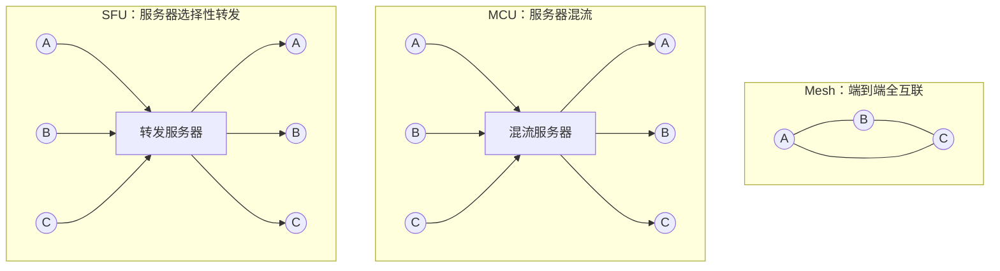
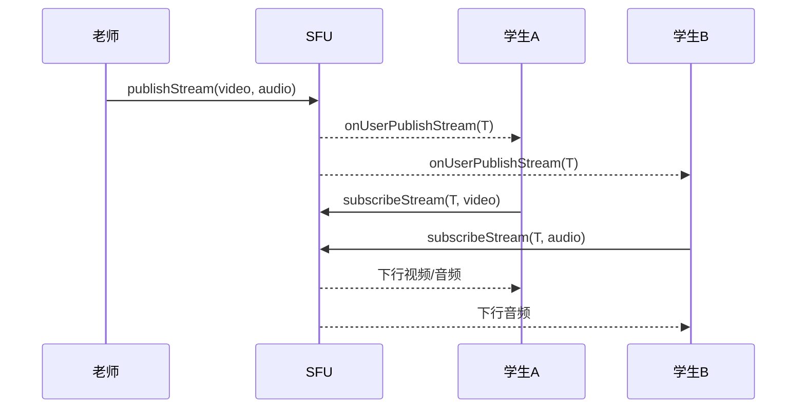
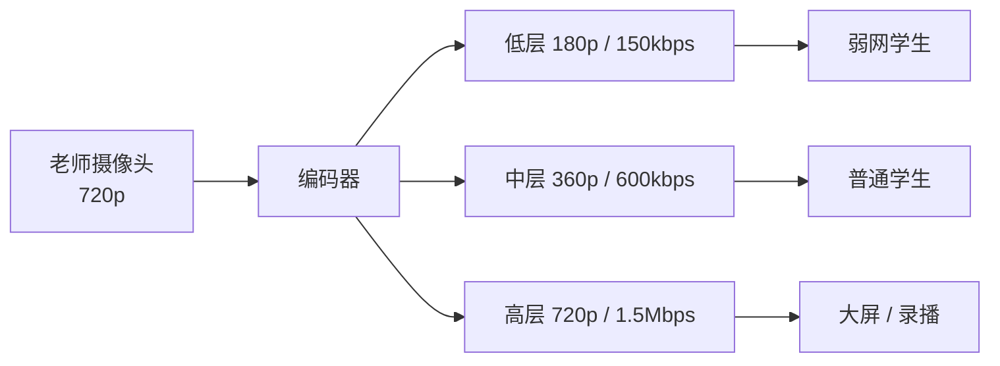
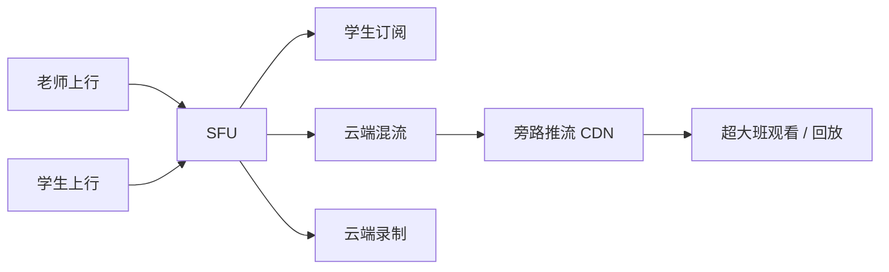
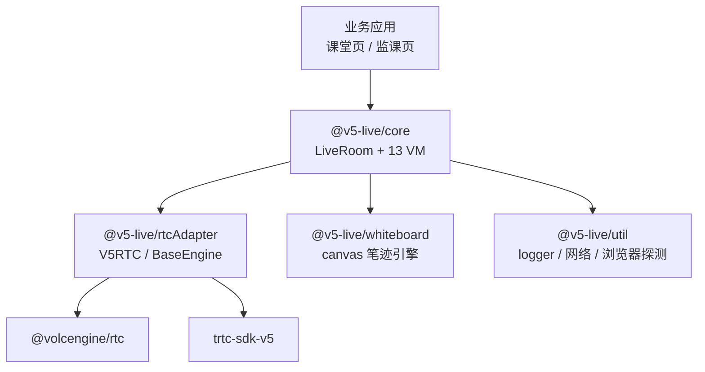

# RTC 架构与发布订阅

同样是「多人音视频」，拓扑选错会让成本和体验同时崩掉。这一章讲清楚 Mesh / MCU / SFU 的差异、发布订阅模型如何映射到课堂角色，以及带宽到底怎么算。

## 1. 三种拓扑



| 维度 | Mesh | MCU | SFU |
| --- | --- | --- | --- |
| 上行路数 | N-1 | 1 | 1 |
| 下行路数 | N-1 | 1（合成画面） | N-1（可分层） |
| 服务端 CPU | 无 | 极高（解码+混流+编码） | 低（只转发） |
| 端到端延迟 | 最低 | 较高（编解码叠加） | 低 |
| 单房间规模 | ≤ 4 人 | 中等 | 大规模 |
| 灵活性 | 高 | 低（画面被合成） | 高（每路独立订阅） |
| 成本 | 带宽随人数平方增长 | 服务器成本高 | 带宽成本线性增长 |

**结论**：小班连麦 3–6 人可以 Mesh，但一旦要「几十人看老师 + 个别人上台」，只有 SFU 能同时满足成本与体验。MCU 更多用于录制、转播、老式电话会议。

## 2. 发布订阅模型

SFU 把「谁在说话」和「谁在看」解耦成两个动作：



流的身份通常由三元组定位：

| 维度 | 取值 | 说明 |
| --- | --- | --- |
| `userID` | 用户 | 谁发布的 |
| 媒体类型 | `video` / `audio` | 主流还是音频 |
| `streamIndex` / `streamType` | 主流 / 屏幕流 / 副摄像头 | 同一用户可有多路 |

工程含义：

- **发布成功 ≠ 别人能看到**。必须有人订阅。
- **订阅是逐用户、逐媒体类型的**，可以只订阅音频（省带宽）或只订阅屏幕流。
- 大班场景常见策略：订阅老师全部流，订阅台上学生视频，其余学生只订阅音频。

## 3. 分层编码：让一路流适配所有人的网络

同一个画面，网络好的学生要 720p，地铁里的学生只要不断线。这靠分层编码实现：

| 方案 | 原理 | 优点 | 代价 |
| --- | --- | --- | --- |
| Simulcast | 编码器同时产出多个分辨率/码率的独立流 | 实现简单、兼容性好 | 上行带宽与 CPU 成倍增加 |
| SVC | 一次编码，时域/空域/质量分层可裁剪 | 上行只编一次 | 编解码器支持要求高 |
| 双流（大小流） | 只出高低两档 | 成本最低 | 粒度粗 |



订阅策略要跟着**角色**走，而不是跟着「在线用户」走：

| 角色 | 订阅策略 | 理由 |
| --- | --- | --- |
| 大班学生 | 老师视频高层 + 台上学生低层 + 全部音频 | 主画面清晰即可 |
| 老师 | 台上学生视频中层 + 音频 | 需要看清学生反应 |
| 上台学生 | 自己的本地预览 + 老师和同学的高层 | 互动质量优先 |
| 监课 / 巡课 | 只订阅音频 + 低层视频 | 数量多，控制成本 |

项目把 `isAutoSubscribe` 交给宿主决定（设 `false`），由宿主在 `onUserPublishStream` 里显式订阅——本质就是把「订阅预算」交给业务，而不是 SDK 一刀切。

## 4. 云端能力：混流、旁路、录制



| 能力 | 解决的问题 | 代价 |
| --- | --- | --- |
| 云端混流 | 把多路合成一路，降低下行路数 | 失去单路订阅的灵活性 |
| 旁路推流 | 复用 CDN 承载万人观看 | 延迟升高（通常 1–5s） |
| 云端录制 | 课件 + 音视频合成回放 | 额外计费与存储 |
| 转码 | 统一输出分辨率/编码 | CPU 成本 |

判断标准很简单：**要互动就用 WebRTC，要规模就上 CDN**。两者的延迟差一个数量级，不能既要求 200ms 又要求十万人。

## 5. SEI：随视频帧下发的业务数据

SEI 是 H.264/H.265 码流里的自定义数据段，随帧到达接收端：

| 特点 | 说明 |
| --- | --- |
| 与帧同步 | 天然解决「音画不同步」的时间戳对齐 |
| 带内传输 | 不依赖额外通道，穿透性最好 |
| 不可靠 | 丢帧就丢数据，必须可自愈 |
| 容量有限 | 通常控制在几百字节 |

典型用途：绝对时间戳校准、题目出现时刻、白板页 ID、录播打点。**不适合**传大块业务数据——那应该走信令或 HTTP。

## 6. 项目的分层架构



| 包 | 是否感知课堂语义 | 职责 |
| --- | --- | --- |
| `core` | 是 | 直播间生命周期、13 个 ViewModel、业务信令 |
| `rtcAdapter` | 否 | 抽象 RTC 供应商，统一事件与方法名 |
| `whiteboard` | 否 | 只画不传，笔迹分层与输入滤波 |
| `util` | 否 | 日志、事件、网络与浏览器能力探测 |

`rtcAdapter` 的抽象契约分六组：房间（`joinRoom` / `leaveRoom` / `setUserVisibility`）、发布订阅、采集、屏幕共享、播放、参数配置。业务只认这套方法名，切换火山 VE 与腾讯 TRTC 时不需要改调用方。

两个供应商的差异必须显式抹平：

| 差异点 | 处理方式 |
| --- | --- |
| TRTC 没有 `setParameter` | 提供空实现，避免调用方分支 |
| 事件名不同 | 统一成 `rtcAdapter/events.ts` 的字符串枚举 |
| 设备枚举方式不同 | `initializeStatics` 时切换三套实现 |
| 隐藏自己的语义不同 | 封装成 `setUserVisibility(false)` |

## 7. 带宽怎么算

以「1 位老师 + 100 位学生，720p 主讲」为例：

```text
老师上行     = 1.5 Mbps
服务器下行   = 1.5 × 100 = 150 Mbps   （全部订阅高清）
若学生订阅 360p 层：
服务器下行   = 0.6 × 100 = 60 Mbps
再加上台学生 2 人，各上行 0.8 Mbps、被 100 人订阅低层：
服务器下行  += 0.25 × 100 × 2 = 50 Mbps
```

| 变量 | 影响 | 优化手段 |
| --- | --- | --- |
| 订阅路数 | 线性放大下行 | 只订阅可见画面、只订阅音频 |
| 分层档位 | 直接影响单路带宽 | 按角色下发不同层 |
| 房间规模 | 决定是否需要 CDN | 超过阈值走旁路推流 |
| 上行质量 | 决定老师端是否拥塞 | 主讲端优先保障、独立码率 |

容量规划的经验值：**单场互动课堂的服务器出口 ≈ 订阅路数 × 平均码率 × 安全系数 1.3**。安全系数用于吸收突发订阅（比如切班时全班同时重新订阅）。

## 8. 架构选型的检查清单

- 房间最大同时上行路数是多少？超过 6 路基本就不要考虑 Mesh。
- 是否需要每个学生独立视角（看不同的流）？需要就排除 MCU。
- 是否存在万人观看场景？存在就规划 CDN 旁路，而不是硬扩 SFU。
- 是否要求录制与回放？提前确认云端录制对编码格式的要求。
- 是否需要跨云容灾？抽象层必须支持运行时切换供应商。

## 9. 相关章节

- 每个端如何与 SFU 建立连接：[信令、SDP 与 ICE](/webrtc/signaling)
- 课堂角色如何映射成订阅策略：[进房、连麦与白板协同](/webrtc/classroom)
- 码率被网络压下去之后发生了什么：[弱网对抗与质量指标](/webrtc/weak-network)
