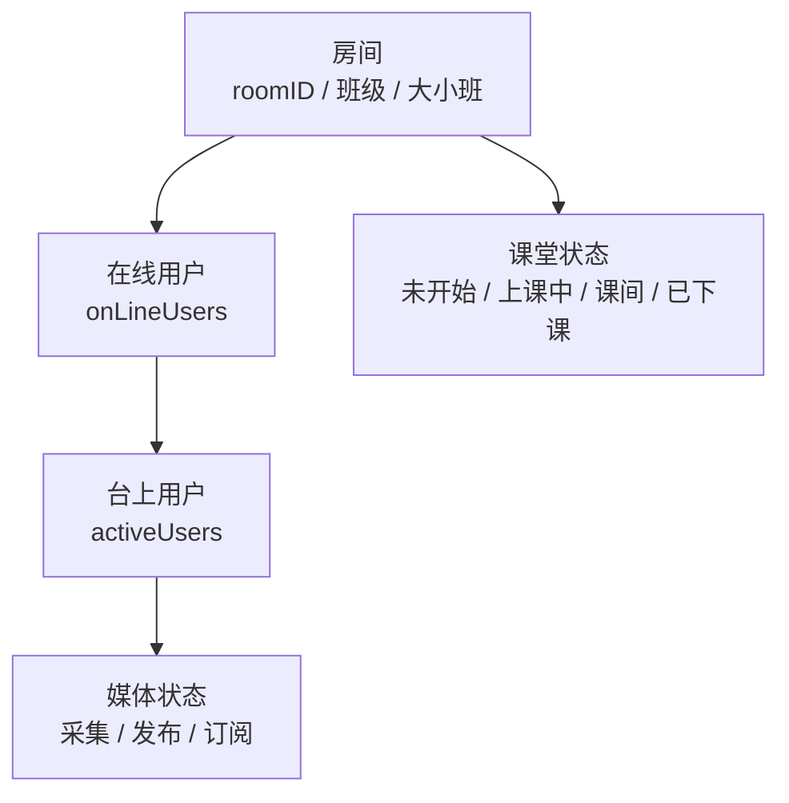
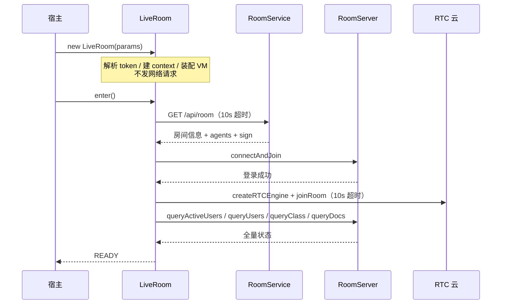
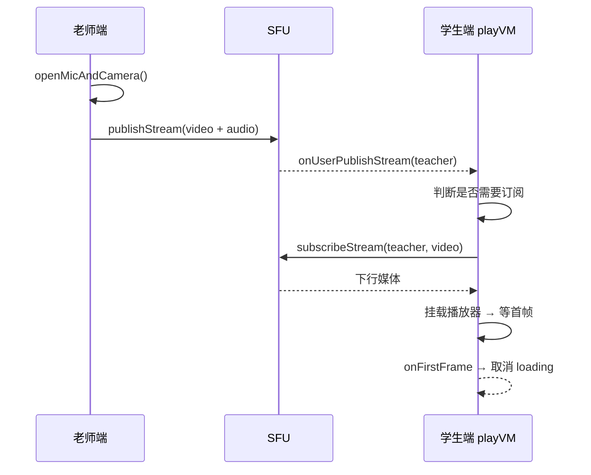
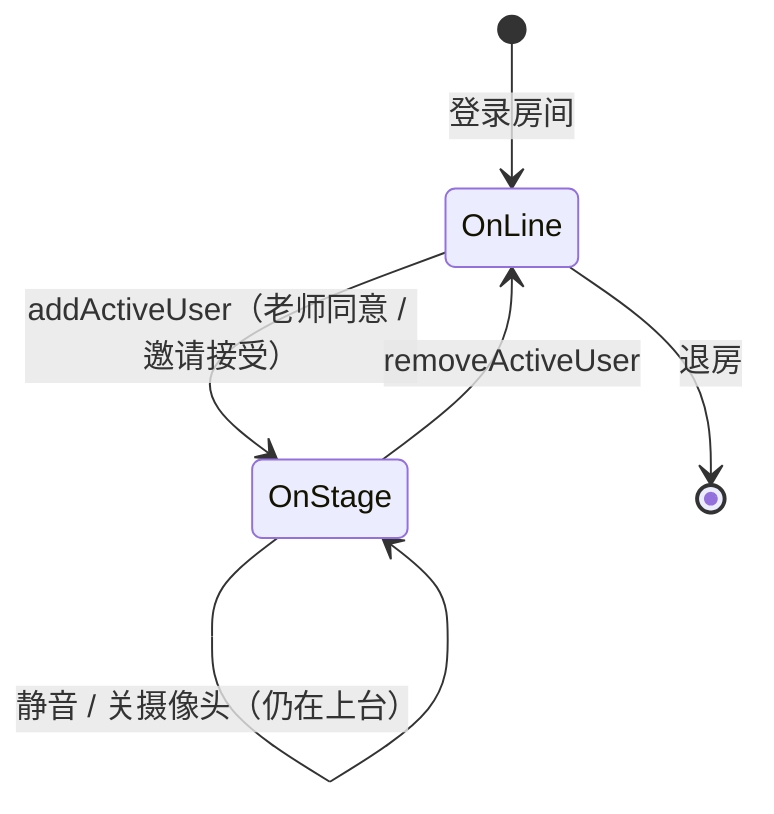
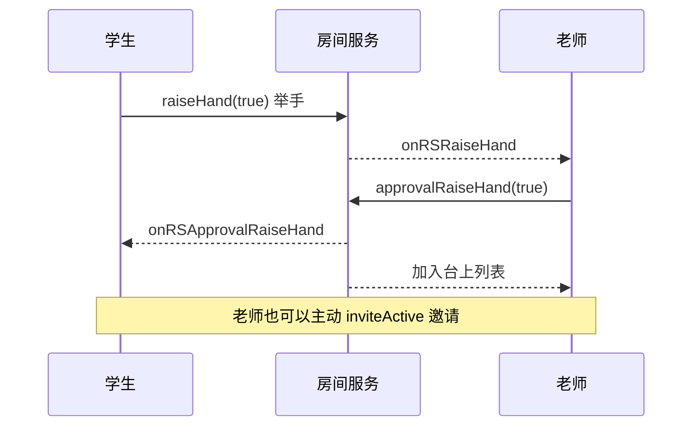
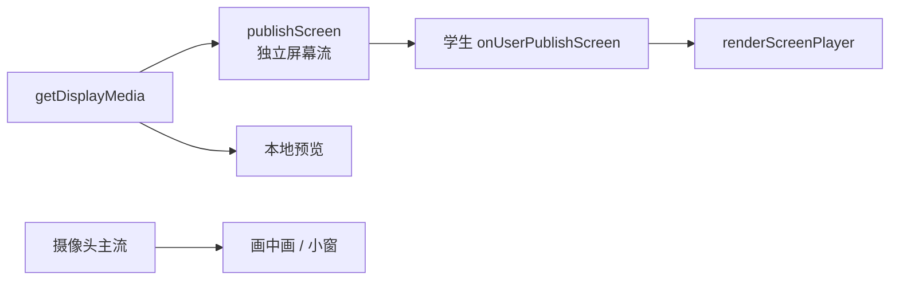
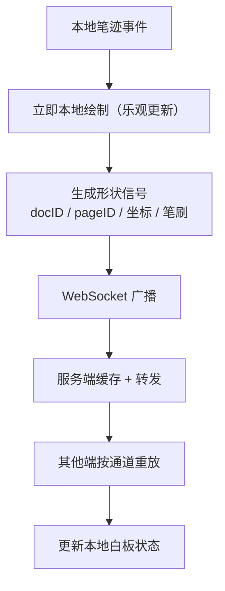
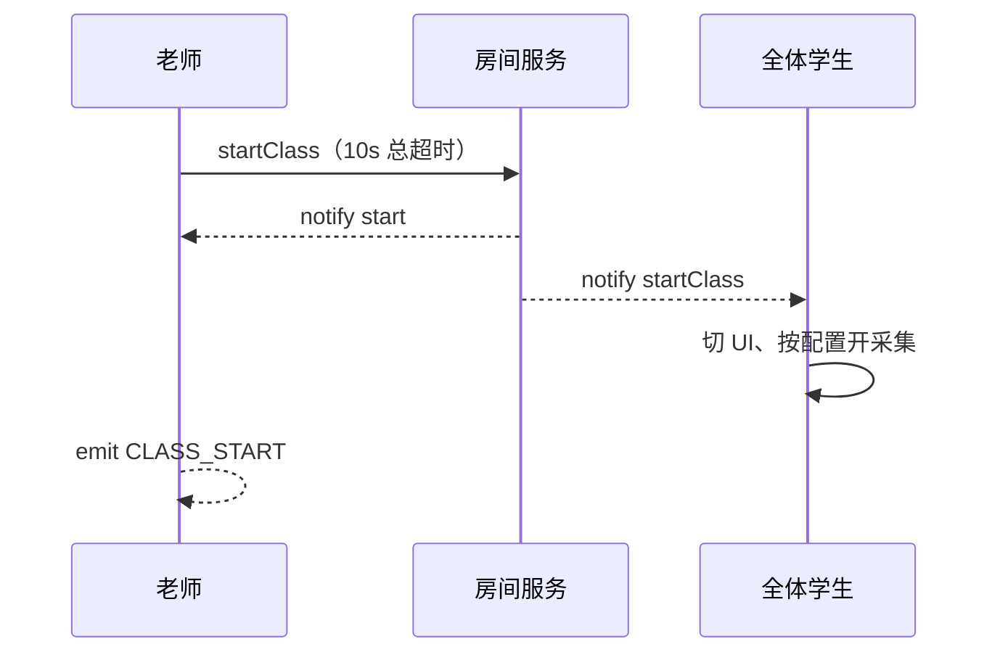
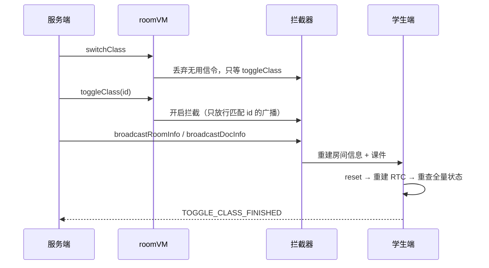
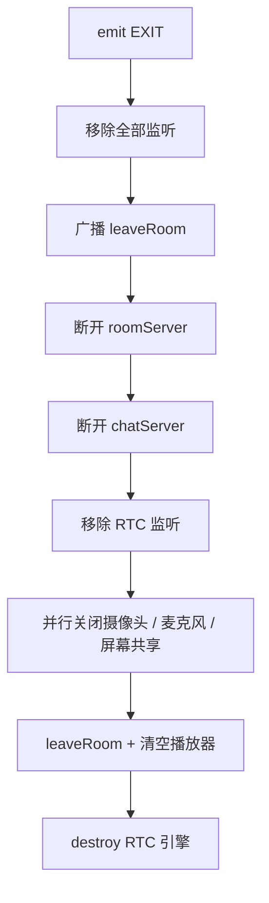

# 进房、连麦与白板协同

前三章讲的是通用 WebRTC。这一章把它落到在线教育直播间的真实链路上：一次完整的「进房 → 上课 → 连麦 → 切班 → 退房」，以及每一步容易出问题的地方。

## 1. 角色与状态模型

课堂里不是「一个房间若干人」，而是四层状态：

| 概念 | 含义 | 影响 |
| --- | --- | --- |
| 房间 | 一次上课的容器 | 决定大小班、供应商、课件 |
| 在线 | 已登录房间服务 | 能收信令，但不一定有媒体 |
| 台上 | 被允许发言/露脸 | 才允许采集与发布 |
| 课堂状态 | 上课/课间/下课 | 决定采集策略与交互权限 |

**最容易混淆的是「在线」与「上台」**。学生默认在线但不在台上，只能订阅不能发布；老师把学生拉上台（`addActiveUser`）后，学生才会开麦开摄像头。

## 2. 进房链路

几个设计要点：

1. **构造不联网**。`new LiveRoom` 只做 token 解析与 VM 装配，所以构造失败不等于进房失败，日志要分开看。
2. **`READY` 不等于上课**。它是「登录房间服务 + 设备就绪」的边界，上课由 `startClass` 单独触发。
3. **拉房间信息必须拿到 `agents` 与 `sign`**。缺一个就不该继续，否则后面连上也会被拒。
4. **RTC 进房有独立超时**。`ensureJoinRoom` 10s 未完成报超时，而不是挂死。

进房失败要分类处理：

| 服务端 code | 含义 | 处理 |
| --- | --- | --- |
| `RoomNotStart` | 未到上课时间 | 提示时间，不重试 |
| `TokenExpired` / `TokenNotMatch` | 凭证失效 | 重新换取 token 或退出 |
| `TeacherAlreadyExists` | 老师重复进入 | 非致命，允许继续 |
| `ToggleBJY` | 房间被切到备用平台 | 跳转，不重连 |

## 3. 发布与订阅的时序

订阅侧工程细节：

- **订阅失败要重试**。项目里 `subscribeStream` 失败重试 4 次、间隔 1.5s，仍失败才抛出订阅失败事件。
- **首帧才算真的出来**。收到 `onUserPublishStream` 只代表有流，用户看到的黑屏要等首帧事件。
- **取消订阅要彻底**。用户离开或下台时清理订阅表、音量缓存与播放器 DOM，否则重进会重复渲染。

## 4. 上下台：媒体权限的开关

| 事件 | 自己 | 他人 |
| --- | --- | --- |
| 收到上台通知 | 自动开麦/开摄像头（按课堂配置） | 只登记列表 |
| 收到下台通知 | 关闭采集与发布 | 取消订阅并清理画面 |
| 被老师静音 | 只切 `isMicMuted`，不停止采集 | 更新 UI 状态 |

为什么要区分「静音」和「停止采集」：静音只是不发声音，恢复更快；停止采集会释放设备，但重新打开需要几百毫秒且可能触发权限弹窗。课堂里点名问答频繁，默认用静音。

## 5. 连麦：三条路径，一套状态

| 路径 | 触发 | 关键状态 |
| --- | --- | --- |
| 学生申请 | 举手 → 老师同意 | 60s 倒计时，超时自动取消 |
| 老师邀请 | `inviteActive` → 学生接受 | 60s 未响应视为拒绝 |
| 老师点名 | 直接 `addActiveUser` | 无审批，直接上台 |

约束与坑：

- **台上有人时不能再邀请**。否则会出现「两个学生同时说话」，多数 RTC 混音策略无法处理。
- **设备权限要在接受邀请前检查**。项目在 `agreeInvite` 里先 `enableDevices({ audio: true })`，失败则按「无设备权限」拒绝，而不是先上台再失败。
- **拒绝要带原因**。`EInviteRefuseReason` 让老师知道是「学生拒绝」还是「设备不可用」，否则只能反复邀请。
- **超时两侧都要清**。学生侧倒计时结束发取消，老师侧列表同样要移除过期项。

## 6. 屏幕共享与多路流

- 屏幕流与摄像头流是**两条独立的流**，学生可以同时看到老师和课件。
- 主讲屏幕的分辨率优先，帧率可降到 15 fps。
- 用户点击浏览器的「停止共享」会结束轨道，必须同步取消发布并回到摄像头画面，否则学生端会一直停在最后一帧。
- 屏幕共享期间若切换课件，只换渲染层，不重建 RTC 连接。

## 7. 白板：为什么它不走 WebRTC

这是教育场景里最值得单独讲的一点。

不走 DataChannel 的三个原因：

| 需求 | DataChannel | WebSocket |
| --- | --- | --- |
| 服务端缓存、迟到者补全 | 做不到 | 天然支持 |
| 与课件页、权限、回放对齐 | 需另建通道 | 复用同一信令 |
| 断线重连后恢复 | 连接即断，历史丢失 | 拉全量后重放 |
| 审计与回放 | 无服务端记录 | 有完整信号序列 |

实现要点：

- **通道按 `${docID}-${pageID}` 划分**，同页多视图共享一个通道。
- **信号分两类**：`operate`（形状）与 `pen`（激光笔），激光不落盘、自动消退。
- **本地先画，远端后到**。自己的信号回来时只校正层级（`layerIndex`），不重绘，避免闪一下。
- **每条信号 5s 超时**，超时只记日志不阻塞后续绘制——板书是高频操作，不能因为一条信号卡住整个交互。
- **重进房间先拉历史信号**，再接管增量；否则会看到「白板是空的但老师在讲」。

## 8. 上课、下课与切班

### 8.1 上课

上课失败常见原因是**大班老师还没切到大班**：`startClass` 内部先 `toggleClass(Big)`，再等切班完成，超时 10s。所以「点了上课没反应」先看切班是否成功，而不是看信令。

### 8.2 切班（双师大小班）

切班是课堂里最复杂的状态迁移：**RTC 要重建，信令要拦截，状态要覆盖**。

三个必须理解的点：

1. **切班期间的消息会被丢弃**。只有匹配 `id` 的广播才放行，其余入队。这就是为什么「切班后黑屏」要先查广播的 `id` 是否与 `toggleClass` 一致。
2. **要等组件就绪再宣布完成**。重建后需要延迟约 500ms 等画笔、播放器挂载，否则学生端会丢第一帧。
3. **兜底必须存在**。切班流程有 10–15s 兜底刷新，宁可让用户重进，也不能卡在半切换状态。

## 9. 退房：顺序是硬约定

顺序错乱会导致两类问题：**退房后还收到消息**（监听没移除），以及**设备指示灯不灭**（采集没停）。并行关闭采集是为了缩短退房耗时，但 `destroy` 必须在最后，否则关闭轨道时没有引擎可用。

## 10. 一条链路的验收清单

| 环节 | 验收标准 |
| --- | --- |
| 进房 | 3s 内到 READY；失败有明确 code |
| 发布 | 开麦 1s 内可上行；失败有采集/发布错误码 |
| 订阅 | 首帧 < 1.5s；订阅失败有重试且不卡 UI |
| 连麦 | 双向 60s 超时；拒绝原因可展示 |
| 屏幕共享 | 共享/停止都能同步两端状态 |
| 白板 | 双方笔迹 < 300ms；重进能看到历史 |
| 切班 | 黑屏 < 2s；失败可兜底刷新 |
| 退房 | 设备灯灭、无残留监听、可重新进房 |

## 11. 相关章节

- 采集状态机细节：[媒体采集与设备管理](/webrtc/media)
- 信令超时、拦截与重连：[信令、SDP 与 ICE](/webrtc/signaling)
- 课堂卡顿与掉线的量化分析：[弱网对抗与质量指标](/webrtc/weak-network)
