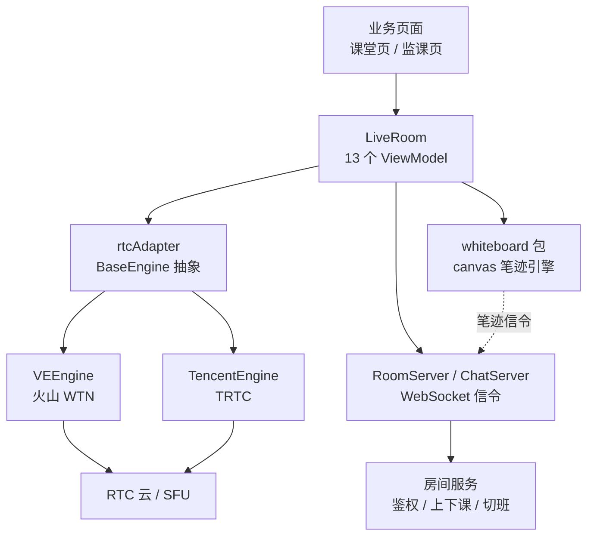

# WebRTC 与实时互动课堂：专栏导读

> 一套面向「在线教育直播间」的 WebRTC 知识地图。既不满足于「会调 SDK」，也不陷入协议细节无法落地——每一章都对应到真实项目里的模块与故障场景。

## 这个专栏解决什么问题

在线教育直播间的本质，是**把四类实时数据可靠地送到对的人手里**：

| 数据类型 | 典型载体 | 要求 |
| --- | --- | --- |
| 音视频媒体 | RTC（WebRTC / 火山 VE / 腾讯 TRTC） | 低延迟、抗弱网、可分层 |
| 课堂控制信令 | WebSocket | 有序、可回执、可拦截 |
| 板书与课件操作 | WebSocket（形状信号） | 可重放、可缓存、可断线恢复 |
| 业务状态 | HTTP + 信令 | 最终一致、可补偿 |

只懂其中之一，就会在排障时迷失：明明是「学生看不到老师」，可能是采集没开、可能是发布成功但订阅没做、可能是自动播放被浏览器拦截，也可能是 ICE 没打通。本专栏按「采集 → 信令 → 拓扑 → 课堂链路 → 弱网 → 排障」的顺序拆开这条链。

## 与技术栈的关系

本专栏以两套体系对照讲解：

- **标准 WebRTC**：`getUserMedia` / `RTCPeerConnection` / SDP / ICE / DTLS-SRTP，是所有 RTC 的公共底座。
- **本项目实践**：`@v5-live/core` 通过 `rtcAdapter` 抽象了**火山引擎 VE** 与**腾讯 TRTC** 两套云端 SDK，业务侧只与 `LiveRoom` 和 13 个 ViewModel 交互。

关键边界：**SDK 只负责媒体与画布，不负责课堂语义**。谁上台、谁能说话、课件翻到第几页，全部由信令层定义。

## 章节结构与阅读路径

| 章节 | 解决的核心问题 | 对应项目模块 |
| --- | --- | --- |
| [媒体采集与设备管理](/webrtc/media) | 摄像头/麦克风/屏幕怎么拿到、参数怎么定、轨道为什么断 | `captureVM`、`deviceManager`、`setVideoResolution` |
| [信令、SDP 与 ICE](/webrtc/signaling) | 连接是怎么建立的、为什么连不上、断线后怎么恢复 | `V5Websocket`、`RoomServer`、`Sender` 族 |
| [RTC 架构与发布订阅](/webrtc/architecture) | Mesh/MCU/SFU 怎么选、分层编码与带宽怎么算 | `rtcAdapter`、`playVM`、云端混流 |
| [进房、连麦与白板协同](/webrtc/classroom) | 一条完整的课堂主链路：进房 → 上课 → 连麦 → 切班 → 退房 | `LiveRoom`、`loadingVM`、`mediaCallVM`、`whiteboardVM` |
| [弱网对抗与质量指标](/webrtc/weak-network) | 卡顿、花屏、掉线怎么量化与缓解 | `playVM` 网络质量事件、`anomalyReporter` |
| [排障手册与高频问题](/webrtc/troubleshooting) | 出问题时按什么顺序查、看哪些指标 | `webrtc-internals`、`getStats`、日志关键字 |

## 十个必须先建立的概念

| 概念 | 一句话解释 | 常见误区 |
| --- | --- | --- |
| 信令（Signaling） | 交换 SDP 与候选地址的**业务通道**，WebRTC 本身不规定 | 以为 `RTCPeerConnection` 会自动找到对方 |
| SDP | 媒体能力与网络参数的文本描述 | 以为 SDP 是「配置」而非「协商结果」 |
| ICE | 用 STUN/TURN 找出双方可达路径的过程 | 认为有公网 IP 就不需要 TURN |
| DTLS-SRTP | 媒体加密：DTLS 握手协商密钥，SRTP 加密传输 | 把它和 HTTPS 证书体系混为一谈 |
| SFU | 每个端只上行一路，由服务器转发多路 | 以为大班课堂是「老师直连所有学生」 |
| 发布/订阅 | 先 publish 自己的流，再由别人 subscribe | 以为发布了对方就一定会收到 |
| Simulcast / SVC | 同一路视频编出多个质量层，按需下发 | 把它和「多路摄像头」混为一谈 |
| 3A | AEC 回声消除、ANS 降噪、AGC 自动增益 | 以为开了 3A 就一定没有回声 |
| 自动播放策略 | 无用户手势时浏览器可能拒绝播放/挂起音频 | 只处理 `video.play()` 的 Promise |
| SEI | 随视频帧下发的带内自定义数据 | 用文本消息传时间戳导致音画不同步 |

## 本项目的技术取舍

**为什么同时接火山 VE 和腾讯 TRTC**：房间配置里的 `rtcConfig.rtcVendor` 决定引擎（`VOLCANO=2` / `TENCENT=3`），迁云、容灾、地域合规都可以按房间灰度，而不改业务代码。

**为什么白板不走 DataChannel**：板书信号需要**服务端缓存、跨端重放、断线恢复和权限校验**，DataChannel 是端到端的，天然做不到；项目里笔迹走 WebSocket 广播（`operateShape` / `operatePen`），白板包只负责画、不负责传。

**为什么宿主把 `isAutoSubscribe` 设为 `false`**：大班课堂同时可能有几十路流，全量订阅会把下行带宽打满。宿主按「台上用户 + 当前可见画面」显式订阅，把带宽花在看得见的地方。

## 自检清单

读完这个专栏，你应该能回答：

- 学生反馈「听不到老师」，如何按「采集 → 发布 → 订阅 → 播放 → 渲染」五层定位？
- 为什么 ICE 连接成功但视频一直黑屏？先看哪些 `getStats` 字段？
- 教室网络抖动到 20% 丢包时，音频和视频分别靠什么机制保命？
- 断线重连后，为什么要拉一次全量状态而不是重放增量信令？
- 大班 1 对 100 的课堂，服务器出口带宽怎么估算？
