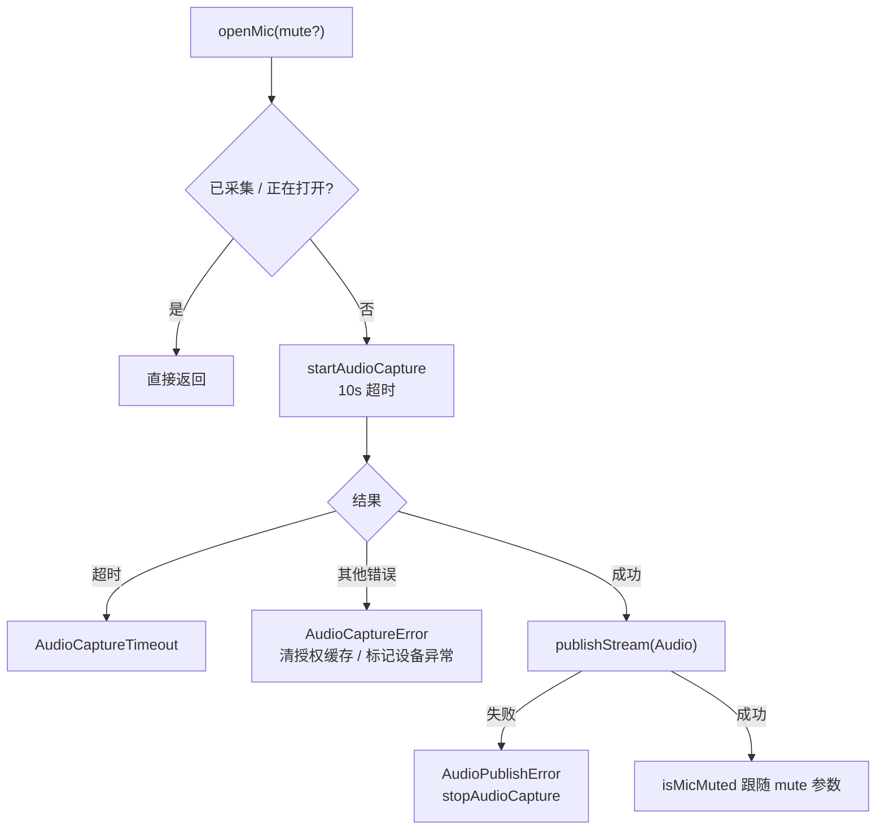

# 媒体采集与设备管理

采集是整条实时链路的源头。源头参数错了，后面的编码、传输、渲染再优化也救不回来：分辨率开太高导致上行拥塞、采样率不匹配导致变声、轨道结束后没有重建导致「有画面没声音」。

## 1. 采集在链路中的位置


采集侧能控制的是 A~D，传输质量由 E~H 决定。排查「画面模糊」时先分清是哪一段：采集分辨率不够，还是编码码率被压，还是订阅端拿的是低层流。

## 2. getUserMedia：约束不是「建议」

```ts
const stream = await navigator.mediaDevices.getUserMedia({
    audio: {
        deviceId: { exact: micId },
        echoCancellation: true,
        noiseSuppression: true,
        autoGainControl: true,
        sampleRate: 48000,
    },
    video: {
        deviceId: { exact: cameraId },
        width: { ideal: 1280 },
        height: { ideal: 720 },
        frameRate: { ideal: 30, max: 30 },
    },
});
```

约束求解规则：

| 写法 | 语义 | 结果 |
| --- | --- | --- |
| `{ ideal: 1280 }` | 尽量满足 | 不满足也返回可用值 |
| `{ exact: 1280 }` | 必须满足 | 不满足直接 `OverconstrainedError` |
| `{ min: 640, max: 1280 }` | 区间 | 在区间内选最接近的 |
| `{ width: 1280 }` | 简写，等同 ideal | 常见误写成强制约束 |

两个工程约束：

1. **必须安全上下文**。`localhost` 或 HTTPS，否则 `navigator.mediaDevices` 直接是 `undefined`——表现为「线上能用、内网 IP 调试不能用」。
2. **一次只申请必要权限**。同时申请摄像头与麦克风会让用户面对一个更吓人的弹窗，拒绝率更高。项目里的 `openMic` / `openCamera` / `openMicAndCamera` 就是三条不同的申请路径，并用 `isOpeningMic` / `isOpeningCamera` 互斥，避免并发弹窗。

## 3. 错误分类：不同错误要有不同兜底

| 错误名 | 含义 | 正确处置 |
| --- | --- | --- |
| `NotAllowedError` | 用户拒绝或浏览器策略禁止 | 引导授权，不要立刻重试 |
| `NotFoundError` | 没有匹配设备 | 重新 `enumerateDevices`，降级到默认设备 |
| `NotReadableError` | 设备被占用、驱动异常 | 提示「设备被其他应用占用」，允许重试 |
| `OverconstrainedError` | 约束无法满足 | 去掉 `exact`，用 `ideal` 重试 |
| `AbortError` | 系统层中断（如切后台） | 延迟重试 |
| `SecurityError` | 非安全上下文 | 检查 HTTPS |

项目里把超时和错误分开处理：`openMic` 10s 未完成报 `AudioCaptureTimeout`，其余错误报 `AudioCaptureError`，并清掉 `v5live_hasMicGranted`、把设备标记为异常。**区分「超时」和「拒绝」很重要**——前者可能是驱动卡死，后者是用户行为，重合期的重试策略完全不同。

## 4. 参数怎么定

### 4.1 视频：分辨率、帧率、码率是三角关系

| 档位 | 分辨率 | 帧率 | 推荐码率 | 适用 |
| --- | --- | --- | --- | --- |
| 流畅 | 640×360 | 15 | 300–500 kbps | 弱网、小窗 |
| 标清 | 640×360 | 24 | 500–800 kbps | 学生摄像头 |
| 高清 | 1280×720 | 30 | 1.2–2 Mbps | 老师主讲 |
| 超清 | 1920×1080 | 30 | 2.5–4 Mbps | 大屏课件、录播 |

经验公式：`码率 ≈ 宽 × 高 × 帧率 × 运动系数 × 0.07 / 1000`（kbps），运动系数按画面复杂度取 0.05~0.15。文档/PPT 场景画面静止，可以显著降低码率——这也是为什么屏幕共享应该走**独立参数**，而不是复用摄像头参数。

### 4.2 音频：48 kHz 是默认答案

| 参数 | 建议值 | 说明 |
| --- | --- | --- |
| 采样率 | 48000 Hz | Opus 原生支持，重采样损失最小 |
| 声道 | 单声道 | 人声场景双声道只增加码率 |
| 码率 | 32–64 kbps | 48 kbps 是语音清晰度与带宽的平衡点 |
| 帧长 | 20 ms | 抗丢包与延迟的折中 |
| 3A | 按场景 | 外放必须 AEC；专业麦克风可关 ANS/AGC |

采样率不一致不会报错，只会**变声或变速**。项目里把 `sampleRate` 固定 48000，就是为了避免不同设备协商出 44.1 kHz 后音频链路反复重采样。

项目 `initRTCConfig()` 的优先级是：普通用户取 `rtcConfig.default`，老师取 `rtcConfig.teacherDefault`；音频档位取 `rtcConfig.audioProfile`，但 iOS 强制 `EAudioProfile.Normal`——移动端高音质档位会显著抬高 CPU 与发热。

## 5. 轨道的生命周期

`MediaStreamTrack` 不是「一次拿到永久有效」：

```ts
track.onended = () => {
    // 设备被拔出、被系统抢占、屏幕共享被用户停止
};
track.onmute = () => {
    // 临时静音（切后台、系统通话抢占）
};
```

三类典型场景：

| 场景 | 表现 | 处理 |
| --- | --- | --- |
| 拔掉 USB 摄像头 | `track.ended` | 重新枚举设备，切换到内置摄像头 |
| 蓝牙耳机断开 | 音频轨 `ended` 或系统自动切回扬声器 | 重新采集，避免「看起来开着麦但没声音」 |
| 屏幕共享被停止 | 屏幕轨 `ended` | 结束共享状态并通知服务端取消发布 |

项目在 `isKeepMicOpen` 模式下监听 `onTrackEnded`，会重新枚举设备并在 5s 节流后重采——**节流是必须的**，否则设备反复插拔会触发采集风暴。

## 6. 屏幕共享

```ts
const display = await navigator.mediaDevices.getDisplayMedia({
    video: { frameRate: { ideal: 15 }, width: { max: 1920 } },
    audio: false,
});
```

与摄像头采集的差异：

- 必须由**用户手势**触发，且浏览器会弹出选择器，不能静默调用。
- 分辨率取决于被共享窗口，约束只能设上限。
- 文字清晰度优先于帧率：15 fps + 高分辨率，比 30 fps + 低分辨率更适合讲课件。
- 用户点「停止共享」等价于轨道结束，必须监听 `onended` 收回状态。
- 屏幕流通常作为**独立流**发布（`publishScreen`），而不是替换摄像头轨，这样才能画中画并存。

项目里把屏幕共享、本地屏幕预览、屏幕视频分成多条状态（`captureScreen`、`pushingScreenMediaType`、`mainScreenType`），因为「老师共享了屏幕」和「学生正在看屏幕」是两个不同的事实。

## 7. 自动播放：最容易漏的一环

浏览器自动播放策略会导致两类静默失败：

1. `audio.play()` 返回的 Promise 被 `NotAllowedError` 拒绝。
2. `AudioContext` 创建后处于 `suspended`，音频图不工作——**没有报错，只是没声音**。

处理套路：

```ts
async function ensureAudioUnlocked() {
    const ctx = new AudioContext();
    if (ctx.state === 'suspended') {
        await ctx.resume(); // 必须在用户手势的调用栈里
    }
}
```

工程上的组合方案：

| 手段 | 代价 | 效果 |
| --- | --- | --- |
| 进房前引导点击「进入课堂」 | 多一次交互 | 最稳，一次解锁全链路 |
| 首次静音自动播放，再引导开声音 | 用户可能一直静音 | 画面先出来 |
| 监听播放失败事件，弹出「点击恢复声音」 | 需要 UI 兜底 | 覆盖率最高 |

项目里 `playVM` 发出 `AUTO_PLAY_FAILED`，宿主在回调中补一次 `play()`，同时提供 `resetAudioContext()` 恢复被挂起的音频上下文；`LiveRoom` 甚至接管了 `window.AudioContext`，在退房时统一关闭所有实例，避免 WebAudio 句柄泄漏。

## 8. 项目落地：captureVM 的采集模型



三个采集开关决定了完全不同的生命周期：

| 开关 | 默认 | 行为 | 适用 |
| --- | --- | --- | --- |
| `isKeepMicOpen` | false | 全程保持采集，轨道结束自动重采 | PC / Android |
| `isCaptureWhenNeeded` | false | 仅在需要时采集，节省资源 | iOS / iPad |
| `isExternalAudioStream` | false | 使用外部注入的音频轨 | iOS 外接声卡、录播混音 |

麦克风权限变化也要联动业务：`MediaCallVM` 在失去麦克风权限时**取消举手、拒绝待处理的邀请、关闭麦克风**；恢复时若此前是开启状态则自动重开。否则会出现「举手成功但上台后对方听不到」的幽灵问题。

## 9. 采集侧常见坑

| 现象 | 根因 | 验证方式 |
| --- | --- | --- |
| 本地预览正常，远端无声 | 只启动了采集，没有 `publishStream` | 看发布状态与 `onUserPublishStream` |
| 有画面无声音 | 音频轨被浏览器静音或选择了错误的 `deviceId` | `track.enabled` + `getSettings()` |
| 声音忽大忽小 | AGC 在嘈杂环境反复调整 | 关闭 AGC 或改用外接麦 |
| 自己听到自己 | 本地流被接到了 `<audio>` 播放 | 本地只做预览，不播放音频 |
| 移动端切后台后断流 | 系统回收采集 | 监听 `visibilitychange` 并重建轨道 |
| 屏幕共享越来越卡 | 共享高帧率视频窗口 | 降到 15 fps，限制最大分辨率 |

## 10. 相关章节

- 采集完成后如何建立连接：[信令、SDP 与 ICE](/webrtc/signaling)
- 一路流如何分发给几十个学生：[RTC 架构与发布订阅](/webrtc/architecture)
- 采集正常但对方看不到的排查顺序：[排障手册与高频问题](/webrtc/troubleshooting)
