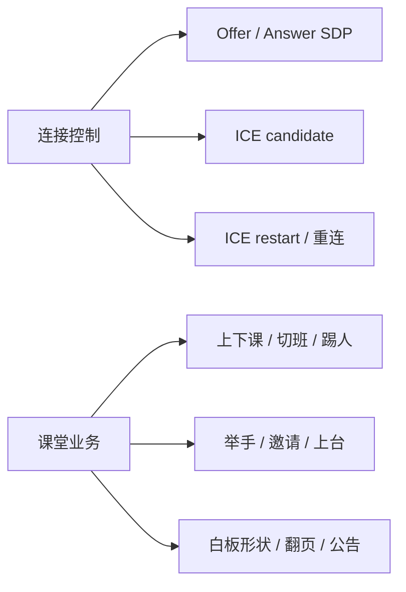
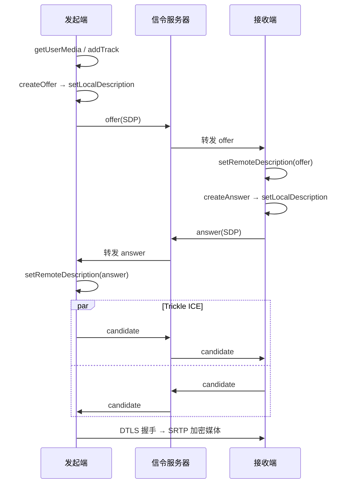
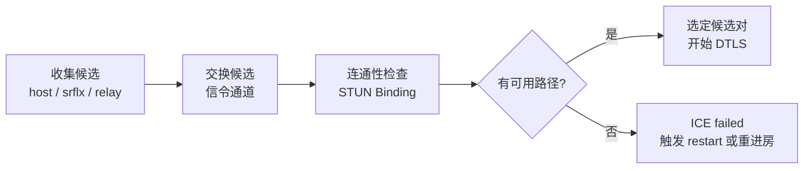
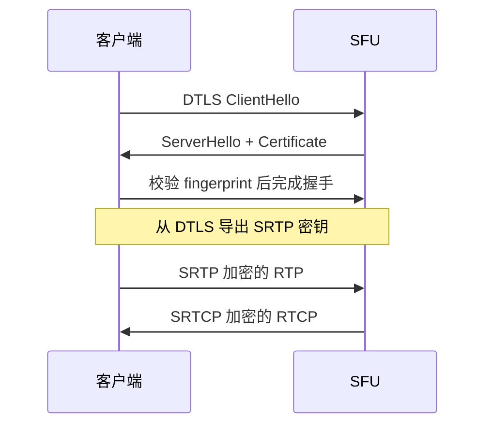
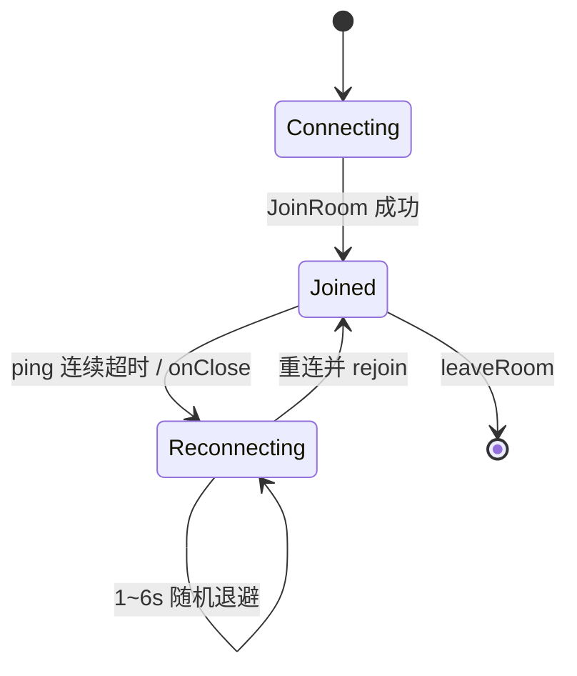
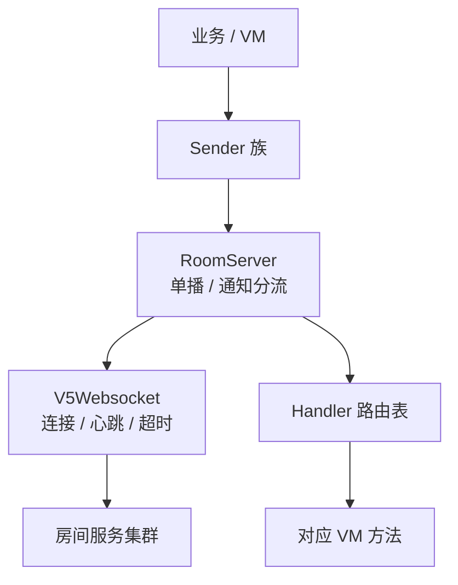

# 信令、SDP 与 ICE

WebRTC 规范里**没有信令**。它只规定了两个端点如何用一个叫 `RTCPeerConnection` 的对象协商媒体、建立加密通道，至于 SDP 和候选地址怎么交换，留给业务自己实现。在线教育里，这根「信令线」还额外承担了举手、上台、翻页、板书、上下课——所以它往往比媒体链路更容易出问题。

## 1. 信令要传什么



- **媒体协商**与**网络候选**是 WebRTC 标准要求的。
- **连接控制**是工程实践：ICE 打不通时主动重启，而不是等 30s 超时。
- **课堂业务**是产品语义，必须有序、可回执、可拦截。

## 2. 一次连接是怎么建立的

标准 WebRTC 的 offer/answer 流程：



在 SFU 架构下，这条流程会发生两次：**每个客户端各自与媒体服务器建一条 PeerConnection**，学生之间不存在直接的 PeerConnection。所以「老师发布、学生订阅」在底层是「老师上行到 SFU，SFU 下行给学生」。

## 3. SDP 解剖

SDP 是纯文本，按行组织，`m=` 段落描述一条媒体流：

```text
v=0
o=- 4611731400430051336 2 IN IP4 127.0.0.1
s=-
t=0 0
m=audio 9 UDP/TLS/RTP/SAVPF 111 63 9 0 8 13 110 126
c=IN IP4 0.0.0.0
a=mid:0
a=sendrecv
a=rtpmap:111 opus/48000/2
a=fmtp:111 minptime=10;useinbandfec=1
a=ice-ufrag:F7gI
a=ice-pwd:x9cml/YzichV2+XlhiMu8g
a=fingerprint:sha-256 6B:8B:F0:...:0E
a=setup:actpass
m=video 9 UDP/TLS/RTP/SAVPF 96 97 98
a=mid:1
a=sendonly
a=rtpmap:96 VP8/90000
a=rtcp-fb:96 nack
a=rtcp-fb:96 nack pli
a=rtcp-fb:96 transport-cc
a=ssrc:1234 cname:abc
```

| 字段 | 作用 | 排查价值 |
| --- | --- | --- |
| `m=` 行 | 媒体类型、端口、传输协议、载荷类型列表 | 数量对不上说明轨道没加进去 |
| `a=sendrecv/sendonly/recvonly/inactive` | 方向 | `inactive` 是最常见的「连上了但没流」 |
| `a=rtpmap` | 编码与时钟频率 | 双方无交集会导致协商失败 |
| `a=fmtp` | 编码参数（如 Opus FEC） | 关掉 `useinbandfec` 会明显削弱弱网表现 |
| `a=rtcp-fb` | 反馈机制（NACK、PLI、transport-cc） | 没有 `transport-cc` 就没有拥塞控制反馈 |
| `a=ice-ufrag` / `a=ice-pwd` | ICE 认证 | 复用错误会导致连通性检查全失败 |
| `a=fingerprint` | DTLS 证书指纹 | 不匹配则媒体加密握手失败 |
| `a=setup` | DTLS 角色 | 双方都是 `active`/`passive` 会卡住 |

**SDP 不是配置，是协商结果。** 改 SDP 前必须理解对端会怎么响应，直接「魔改」是线上事故的常见来源。

## 4. ICE：把「能连上」变成「连得上」

ICE 的任务是找出两端之间可用的网络路径，流程分三步：



| 候选类型 | 来源 | 特点 |
| --- | --- | --- |
| `host` | 本机网卡地址 | 同局域网最快 |
| `srflx` | STUN 服务器反射出的公网地址 | 能穿透大多数 NAT |
| `relay` | TURN 服务器中继 | 一定可用，但成本与延迟最高 |

工程要点：

1. **TURN 不是可选项**。对称型 NAT、企业防火墙封 UDP 的场景，只有 relay 能救。
2. **Trickle ICE 能显著缩短首帧**。不必等候选收集完再发 SDP。
3. **ICE restart ≠ 重新 joinRoom**。网络切换（Wi-Fi → 4G）应优先 ICE restart；只有信令会话也断了才需要重新进房。
4. **mDNS 候选**在部分浏览器默认开启（`xxx.local`），跨网段无法解析，表现为「本地能连、跨网连不上」。

## 5. DTLS-SRTP：媒体为什么是加密的



- 握手用 DTLS 1.2/1.3，证书是自签名的，靠 SDP 里的 `a=fingerprint` 校验。
- 媒体用 SRTP 加密，控制包用 SRTCP。
- **指纹不匹配**的典型表现是 ICE 成功、DTLS 失败、永远没有首帧。
- 企业内网做 TLS 中间盒时，可能破坏 DTLS，需要放行 UDP。

## 6. 信令通道的工程化

### 6.1 为什么是 WebSocket

| 方案 | 延迟 | 双向 | 有序 | 结论 |
| --- | --- | --- | --- | --- |
| HTTP 轮询 | 高 | 否 | 单次内有序 | 仅作兜底 |
| SSE | 中 | 单向 | 是 | 只适合下行通知 |
| WebSocket | 低 | 是 | 是 | 课堂信令的标准选择 |
| DataChannel | 低 | 是 | 可配 | 依赖已建连，不能用于建连本身 |

项目同时维护两条 WS：`roomServer`（课堂控制）与 `chatServer`（聊天，独立重连与限流），互不拖累。

### 6.2 请求-响应要能对上号

```ts
type SignalMessage = {
    jsonrpc: '2.0';
    id: string;        // 请求关联 id
    method: string;    // 业务方法
    params?: unknown;
    roomID?: string;
};
```

工程约定：

- **5s 超时**：没有回包就报 `MESSAGE_TIMEOUT`，避免 Promise 永挂。
- **幂等**：超时重试必须保证重复执行无副作用，例如「开始上课」重发不应重复扣课时。
- **分流**：带 `to` 的是点播（点对点），带 `method` 的是广播/通知。两者混在一个通道里，必须靠结构区分而不是靠猜。
- **过滤**：`currentRoomID` 与本地不一致的消息要丢弃，否则切班期间会串班。

### 6.3 心跳与重连



项目里 `ping` 每 10s 一次，连续 3 次无响应判定超时；`onClose` / `onError` 走 1–6s 随机重连，避免服务端故障恢复瞬间被全部客户端打垮。**随机退避比固定间隔重要**，这是雪崩防护。

### 6.4 重连后必须做状态重建

重连成功不等于状态正确：断线期间可能有人上台、有人下课、课件翻页、老师被踢。所以重连后要**拉全量**：

| 查询 | 恢复的状态 |
| --- | --- |
| `queryActiveUsers` | 台上用户、自己的上下台状态 |
| `queryUsers` | 在线名单、角色 |
| `queryClass` | 上课状态、开始时间 |
| `queryDocs` | 课件列表与当前页 |
| `queryDisableRaiseHand` / `queryNotices` | 课堂管控与公告 |

增量重放不可行——服务端不一定保留完整历史，顺序也无法保证。**全量覆盖 + 幂等处理**才是正确做法。

## 7. 项目落地：三层信令模型



| 层 | 职责 | 关键点 |
| --- | --- | --- |
| `Sender` | 语义化 API：`query` / `broadcast` / `unicast` / `customData` | 关心响应与不关心响应要分开 |
| `RoomServer` | 消息分流、拦截、回放 | 切班窗口会拦截非白名单消息 |
| `V5Websocket` | 连接、心跳、超时、重连 | 与 RTC 重连解耦 |
| `Handler` | method → VM 方法 | 未知 method 静默丢弃，新增信令必须同步加路由 |

两个易错点：

1. **未知 method 不报错**。忘记注册 handler 的表现是「功能静默失效」，排查时先确认路由表。
2. **切班期间的信令拦截**。只放行 `toggleClass` 与匹配 `id` 的广播，其余入队；如果广播的 `id` 与 `toggleClass` 不一致，会被永久丢弃，表现为「切班后黑屏」。

## 8. 信令与媒体的重连要分开处理

| 故障 | 现象 | 正确处理 |
| --- | --- | --- |
| WS 断开 | 收不到任何课堂事件 | WS 重连 + 拉全量状态 |
| ICE 断开 | 信令正常、媒体中断 | ICE restart；失败再重建 RTC |
| 页面长时间后台 | 心跳被节流、媒体冻结 | 监听 `visibilitychange`，回前台重建 |
| 服务端主动踢人 | 收到 `rejoin` 类消息 | 不重连，直接退出并提示 |

把三者混成一个「重连」逻辑，是弱网体验差的常见根因：媒体抖一下就重进房，学生要重新等 3 秒首帧。

## 9. 相关章节

- 媒体参数如何影响协商结果：[媒体采集与设备管理](/webrtc/media)
- SFU 下为什么要「每个端一条连接」：[RTC 架构与发布订阅](/webrtc/architecture)
- 完整课堂链路的信令时序：[进房、连麦与白板协同](/webrtc/classroom)
