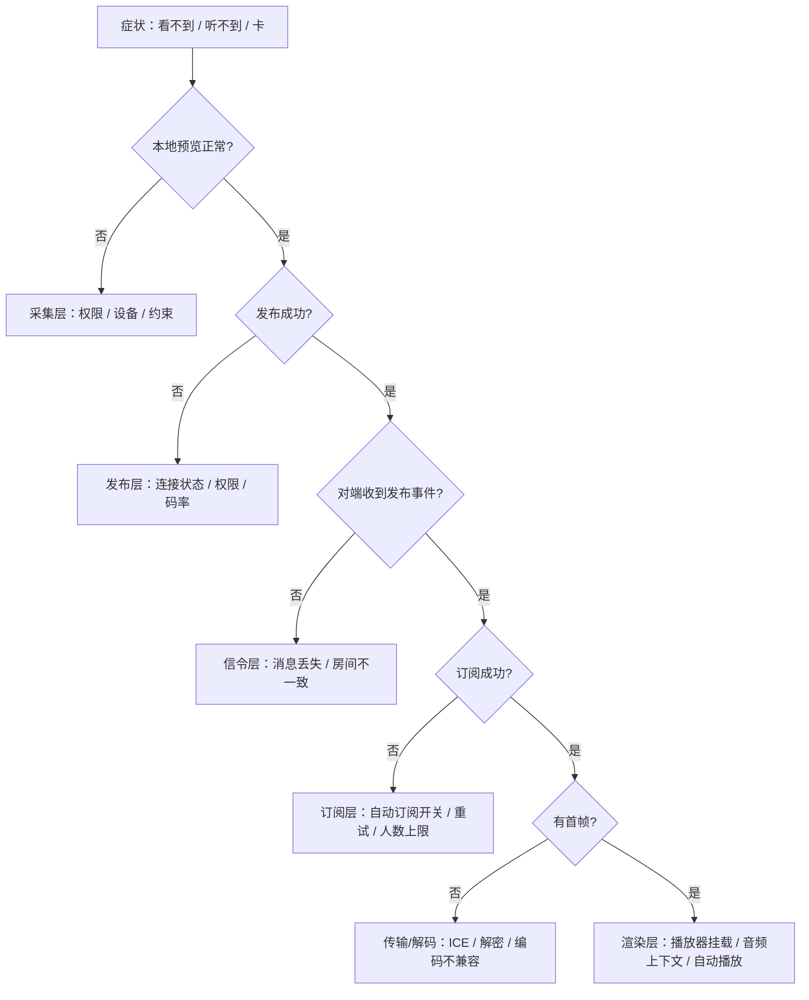

# 排障手册与高频问题

实时音视频的故障有个特点：**症状相同，根因可能在不同层**。「学生看不到老师」可能是权限、采集、发布、订阅、播放、渲染中的任何一环。这一章给出一套可复用的排查顺序，以及课堂场景的高频问题清单。

## 1. 总原则：分层定位，先易后难



固定三步：

1. **确认故障范围**：只有一个人、一个老师、一个班，还是全部？全部优先查服务与配置，个体优先查设备与网络。
2. **确认时间点**：进房就没有，还是中途出现？中途出现优先查网络切换与重连。
3. **确认可复现性**：换设备、换网络、换浏览器是否复现？这决定了是环境问题还是代码问题。

## 2. 工具链

| 工具 | 看什么 | 典型用法 |
| --- | --- | --- |
| `chrome://webrtc-internals` | SDP、候选对、码率、丢包、RTT、ICE 状态 | 抓一次完整会话，对比好/坏两端 |
| `chrome://media-internals` | 解码器、渲染、音频输出 | 排查「有流但黑屏/无声」 |
| `getStats()` | 程序化指标 | 埋点、自动化巡检 |
| 浏览器控制台 | 权限、设备、自动播放报错 | 先看红色错误 |
| 服务端日志 | 进房、上下课、切班、踢人 | 与客户端时间线对齐 |
| 项目日志 | `[ws-*]` / `[reconnect-success]` / `[memory]` / `[fps]` | 定位信令与性能问题 |

## 3. 用 getStats 把「感觉卡」变成数字

```ts
async function collectStats(pc: RTCPeerConnection) {
    const report = await pc.getStats();
    const result: Record<string, unknown> = {};

    report.forEach((stat) => {
        if (stat.type === 'inbound-rtp' && stat.kind === 'video') {
            result.inbound = {
                packetsLost: stat.packetsLost,
                jitter: stat.jitter,
                frameWidth: stat.frameWidth,
                frameHeight: stat.frameHeight,
                framesPerSecond: stat.framesPerSecond,
                framesDecoded: stat.framesDecoded,
                freezeCount: stat.freezeCount,
                totalFreezesDuration: stat.totalFreezesDuration,
                bytesReceived: stat.bytesReceived,
            };
        }
        if (stat.type === 'outbound-rtp' && stat.kind === 'video') {
            result.outbound = {
                bytesSent: stat.bytesSent,
                packetsSent: stat.packetsSent,
                framesEncoded: stat.framesEncoded,
                qualityLimitationReason: stat.qualityLimitationReason,
            };
        }
        if (stat.type === 'candidate-pair' && stat.state === 'succeeded') {
            result.path = {
                currentRoundTripTime: stat.currentRoundTripTime,
                availableOutgoingBitrate: stat.availableOutgoingBitrate,
            };
        }
    });

    return result;
}
```

字段阅读顺序：**连接（candidate-pair）→ 发送（outbound）→ 接收（inbound）→ 渲染（framesDecoded / freezeCount）**。

| 字段 | 异常含义 |
| --- | --- |
| `qualityLimitationReason = bandwidth` | 编码被带宽压制 |
| `qualityLimitationReason = cpu` | 端上算力不足，降分辨率/关特效 |
| `freezeCount` 持续增长 | 接收侧卡顿，结合丢包判断 |
| `availableOutgoingBitrate` 很低 | 上行链路差，先降档 |
| `currentRoundTripTime` > 300ms | 跨地域或链路拥塞 |

## 4. 高频故障速查

| 现象 | 优先怀疑 | 验证方式 | 处理 |
| --- | --- | --- | --- |
| 自己预览正常，对方黑屏 | 没发布或对方没订阅 | 对端看 `onUserPublishStream` | 检查 `publishStream` 与订阅开关 |
| 有画面无声音 | 自动播放被拒 / AudioContext 挂起 | 控制台看 `NotAllowedError` | 用户手势解锁、`resetAudioContext` |
| 有声音无画面 | 视频轨未发布 / 解码失败 / 播放器未挂载 | `getStats` 看 `framesDecoded` | 重建播放器或切编码 |
| 回声 | 外放 + 未开 AEC | 换耳机是否消失 | 开启 AEC，调低扬声器 |
| 声音断续 | 抖动大、丢包高 | `jitter`、`packetsLost` | 加深 jitter buffer、降码率 |
| 花屏 | 丢包超出 FEC 能力 | 丢包率与 NACK 重传率 | 降档、开 FEC |
| 连麦点不动 | 台上已有人 / 未上台 / 权限被禁 | 看台上列表与举手开关 | 提示具体原因，不要静默失败 |
| 上台后对方听不到 | 采集失败但状态已置位 | 查 `AudioCaptureError` 与设备占用 | 回滚上台状态，重新授权 |
| 屏幕共享黑屏 | 共享了受保护窗口 / 轨道已结束 | `track.readyState` | 提示重新选择窗口 |
| 切班后黑屏 | 广播 `id` 与 `toggleClass` 不匹配被丢弃 | 搜拦截日志 | 核对 id，等待兜底刷新 |
| 断线重连后状态错乱 | 只重放了增量 | 查是否拉全量状态 | 重连后重新 query |
| 老师端卡但学生正常 | 主讲分辨率过高、上行拥塞 | `availableOutgoingBitrate` | 降低主讲码率或切低层 |

## 5. 自动播放：最隐蔽的一类

表现：**能收到流、`video.currentTime` 在走、但听不到声音**。

排查顺序：

1. 控制台是否有 `The play() request was interrupted` 或 `NotAllowedError`。
2. `AudioContext.state` 是否为 `suspended`。
3. 页面是否在用户手势之外创建音频上下文。
4. 是否被静音策略静音（`video.muted === true`）。

结论：**任何「能收到流但没声音」的问题，先假设是自动播放策略**。这是最高频、最容易被误判成「RTC 坏了」的故障。

## 6. 日志与埋点该记什么

| 维度 | 字段 | 用途 |
| --- | --- | --- |
| 身份 | `userID` / `roomID` / `role` / `appID` / `version` | 定位到具体会话 |
| 环境 | 浏览器、系统、网络类型、是否客户端内 | 判断是否环境相关 |
| 链路 | 进房耗时、首帧耗时、订阅失败次数 | 体验指标 |
| 质量 | RTT、丢包、卡顿率、码率分位数 | 判断网络问题 |
| 异常 | 错误码、重连原因、切班失败 | 归因 |

三条经验：

- **双时间轴对齐**：客户端与服务器时间要能对上，否则「老师说没声音」和「服务端记录已发布」永远对不上。
- **记录分位数而非平均值**：P95 卡顿率才能真正反映差的那部分用户。
- **保留关键信令片段**：切班、踢人、重连这类低频高影响事件要有完整上下文。

## 7. 高频问题（面试向）

**Q1：WebRTC 为什么需要信令？**
规范只定义媒体协商与传输，不定义如何交换 SDP 与候选地址，也不定义业务语义。信令由业务实现，通常用 WebSocket。

**Q2：ICE 失败常见原因？**
对称 NAT、UDP 被封、TURN 不可用、候选交换不完整、mDNS 候选无法解析、ICE 凭证复用错误。

**Q3：已经连上了但一直黑屏，查什么？**
先看 `inbound-rtp.framesDecoded`：为 0 说明没收到可解帧，查订阅、编码协商、DTLS；不为 0 说明是渲染层，查播放器挂载与 CSS 尺寸（常见 `height: 0`）。

**Q4：为什么大班不用 Mesh？**
上行与下行随人数线性增长，10 人以上上行就不可承受；SFU 每端只上行一路，由服务器转发。

**Q5：Simulcast 和 SVC 的区别？**
Simulcast 编多路独立流，兼容性好但上行翻倍；SVC 一次编码多层可裁剪，上行省但依赖编解码器支持。

**Q6：丢包怎么扛？**
低丢包用 NACK 重传；高丢包转向 FEC + 降码率；音频叠加 Opus FEC 与 PLC，且音频优先于视频。

**Q7：ICE restart 和重新进房的区别？**
ICE restart 只重新收集候选，保留会话与业务状态，适合网络切换；重新进房会重建全部状态，代价大但能修复会话级问题。

**Q8：为什么白板不用 DataChannel？**
需要服务端缓存、迟到补全、断线重放、权限与回放对齐，DataChannel 端到端无法满足。

**Q9：如何估算课堂带宽？**
服务器出口 ≈ 订阅路数 × 平均码率 × 1.3；上行按主讲端单独预算，学生上行只在台上时计算。

**Q10：怎么判断卡顿是网络问题还是性能问题？**
看 `qualityLimitationReason`：`bandwidth` 是网络，`cpu` 是端上算力；再看 `freezeCount` 与丢包是否同步增长。

## 8. 上线前的检查清单

- 权限被拒、设备被占用、设备中途拔出，这三种都有明确提示。
- 自动播放被拒时有可见的恢复入口。
- 订阅失败有重试与超时，不会无限 loading。
- 断线重连后状态与画面都正确，且能自动恢复音频。
- 切班、下课、退房后没有残留监听与未释放的设备。
- 弱网矩阵（2% / 8% / 20% 丢包）都实际跑过。
- 埋点能回答「谁、在什么网络、卡了多久」。

## 9. 相关章节

- 采集与设备错误的分类处理：[媒体采集与设备管理](/webrtc/media)
- 连接建立与重连语义：[信令、SDP 与 ICE](/webrtc/signaling)
- 指标的阈值与降级策略：[弱网对抗与质量指标](/webrtc/weak-network)
