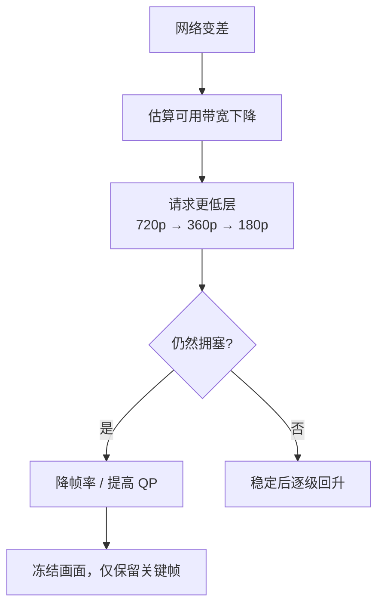

# 弱网对抗与质量指标

实时音视频的体验天花板不是「网络好的时候多清晰」，而是「网络差的时候还能不能上课」。这一章先把「差」量化，再讲每一层各用什么机制兜底。

## 1. 先量化：五个核心指标

| 指标 | 定义 | 健康值 | 超标表现 |
| --- | --- | --- | --- |
| RTT | 往返时延 | < 100 ms | 连麦抢话、互动延迟 |
| 丢包率 | 丢失包 / 发送包 | < 2% | 花屏、卡顿、马赛克 |
| 抖动 | 到达间隔方差 | < 30 ms | 声音断续、忽快忽慢 |
| 卡顿率 | 卡顿时长 / 总时长 | < 1% | 画面冻结 |
| 首帧时长 | 订阅到首帧渲染 | < 1.5 s | 进房黑屏、切班黑屏 |

补充指标：

- **端到端延迟** ≈ 采集 + 编码 + 网络 + jitter buffer + 解码 + 渲染，课堂连麦建议控制在 300 ms 内。
- **FEC 恢复率**、**NACK 重传率**：反映抗丢包机制是否在起作用。
- **发送码率 / 目标码率**：两者长期偏离说明拥塞控制或链路有问题。

## 2. 质量分级

多数 RTC SDK 会把网络质量映射成有限档位：

| 档位 | 含义 | 典型动作 |
| --- | --- | --- |
| Excellent / Good | 正常 | 保持当前档位 |
| Poor | 轻度抖动或丢包 | 降码率、切低层 |
| Bad | 明显卡顿 | 提示用户、优先保音频 |
| VeryBad / Down | 接近不可用 | 提示切换网络、准备重连 |

项目监听上行/下行/RTC 三个质量事件，达到 `Bad`（值 5）时立即提示「网络不佳」，并写入窗口变量供页面 UI 使用。**提示必须早于用户抱怨**，否则用户只会说「你们系统很卡」。

## 3. 传输层：拥塞控制与抗丢包

| 机制 | 解决什么 | 代价 |
| --- | --- | --- |
| 拥塞控制（GCC） | 发送速率匹配可用带宽 | 估算滞后会误判 |
| Pacer | 把突发流量摊平，避免瞬时排队 | 增加少量延迟 |
| NACK | 丢包后请求重传 | 增加一个 RTT，依赖丢包率低 |
| FEC | 冗余包恢复少量丢包 | 固定带宽开销 10%–30% |
| RTX | 独立重传流 | 与 NACK 配合 |
| Jitter buffer | 吸收乱序与抖动 | 深度越大延迟越高 |

**关键取舍**：丢包低时用 NACK（省带宽），丢包高时 NACK 会加剧拥塞，应转向 FEC + 降码率。固定一种策略在弱网下必然失效。

## 4. 音频优先：保命的底线

课堂里「画面糊」可以忍，「听不清」不能忍。所以几乎所有降级策略都是**先砍视频**：

| 手段 | 说明 |
| --- | --- |
| Opus in-band FEC | 在音频包内嵌冗余，单包丢失也能近似恢复 |
| PLC（丢包隐藏） | 用前一帧外推，避免爆音 |
| DTX | 静音期不发包，节省带宽 |
| 音频独立优先级 | 拥塞时视频先降，音频保持码率 |
| 单声道 + 48 kHz + 32–48 kbps | 语音场景的最优区间 |

项目在配置里显式控制 `echoCancellation` / `noiseSuppression` / `autoGainControl`，并固定 48 kHz——这三个开关直接影响弱网下的语音可懂度，不能全开也不能全关。

## 5. 视频分层：让弱网自己「降档」

工程要点：

- **降层比降帧率更有效**，因为低层的码率是编码器预先算好的。
- **回升要慢**，快速升档会造成「降—升—再降」的振荡。
- **关键帧请求（PLI/FIR）**要克制：大量 PLI 会造成码率尖峰，反而加剧拥塞。
- **GOP 不宜过长**：关键帧间隔 2–4s 是首帧速度与码率的平衡点。

## 6. 应用层的兜底

传输层解决不了的部分，要在业务层补：

| 场景 | 兜底手段 |
| --- | --- |
| 订阅失败 | 指数退避重试，最多 4 次；仍失败提示「点击重试」 |
| 首帧超时 | 显示占位图 + 重订阅，不要无限 loading |
| 播放被冻结 | 检测 `currentTime` 长时间不变，主动 `play()` 或重建播放器 |
| 自动播放被拒 | 弹「点击恢复声音」，同时保持静音画面 |
| 断线重连 | 重连后重拉全量状态 + 重新订阅可见流 |
| 页面后台 | `visibilitychange` 时统计失败、回前台重建 |

项目在 `playVM` 里对订阅失败做了 4 次 × 1.5s 的重试，并在页面隐藏期间统计本地流失败次数；这些数据是判断「是网络问题还是我们自己的问题」的关键证据。

## 7. 弱网测试怎么做

| 工具 | 用途 | 注意 |
| --- | --- | --- |
| Chrome DevTools 网络限速 | 粗测带宽 | 不模拟丢包与抖动，不够真实 |
| `chrome://webrtc-internals` | 看实时码率、丢包、RTT、候选对 | 最贴近真实链路 |
| macOS Network Link Conditioner | 模拟 3G / 高丢包 | 需要单独安装 |
| Linux `tc netem` | 精确注入延迟、抖动、丢包、乱序 | 最可控，适合自动化 |
| 真机弱网（电梯、地铁、热点） | 复现真实场景 | 不可重复，但最有说服力 |

建议的测试矩阵：

| 场景 | 丢包 | RTT | 抖动 |
| --- | --- | --- | --- |
| 良好 | 0% | 20 ms | 5 ms |
| 一般 | 2% | 80 ms | 20 ms |
| 较差 | 8% | 150 ms | 50 ms |
| 极差 | 20% | 300 ms | 100 ms |
| 断网抖动 | 100% 间歇 | — | — |

每个场景都要验四件事：能不能出首帧、音频是否可懂、视频是否冻结、恢复后能否自动回到高清。

## 8. 排障时的指标阅读顺序

经验判断：

- **发送码率远低于目标**：上行拥塞或采集参数过高。
- **接收丢包高但发送正常**：下行链路问题，优先降层。
- **RTT 正常、卡顿率高**：多半是解码或渲染卡住，不是网络。
- **ICE 频繁重连**：网络切换或 TURN 不可用，不是码率问题。

## 9. 优化清单

- 主讲端单独配置分辨率与码率，不与学生共用一套参数。
- 大班默认订阅低层，全屏时再切高层。
- 音频码率不随视频一起降。
- 订阅失败必须重试，且重试要退避。
- 断线重连后重拉全量状态，而不是相信本地缓存。
- 所有降级都要有回升路径，否则一次弱网就永久低清。
- 埋点记录 `RTT / 丢包 / 卡顿率 / 首帧` 的分位数，而不是只看平均值。

## 10. 相关章节

- 分层编码与订阅策略：[RTC 架构与发布订阅](/webrtc/architecture)
- 采集参数如何影响上行：[媒体采集与设备管理](/webrtc/media)
- 具体故障的定位步骤：[排障手册与高频问题](/webrtc/troubleshooting)
